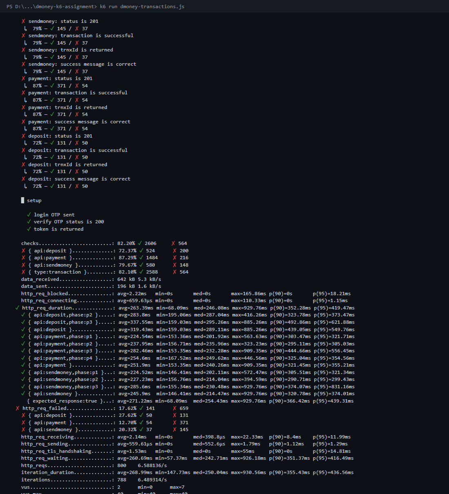
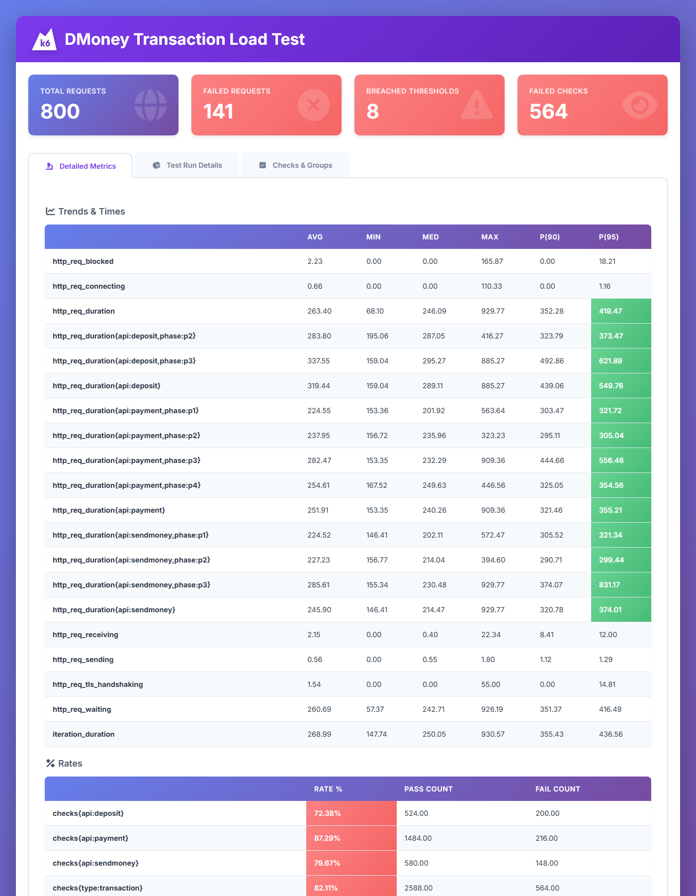
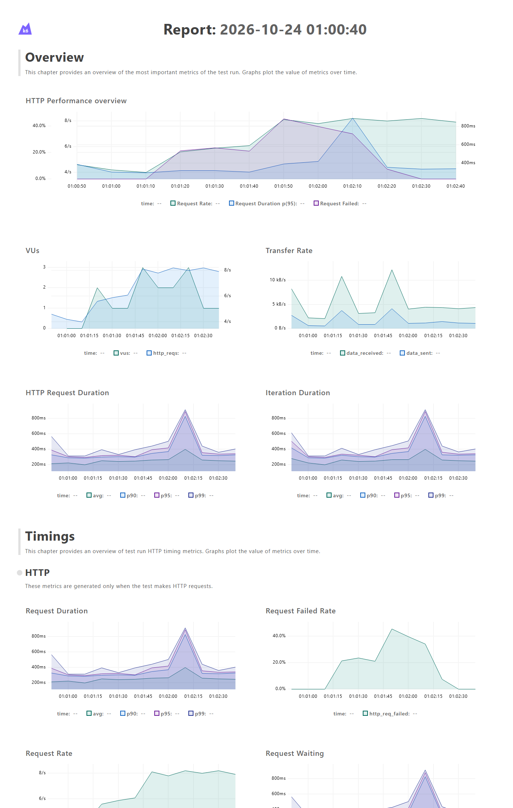

# DMoney Transaction Performance Test (k6)

This k6 test runs DMoney transactions for **2 minutes** with 6 test users: 2 Agents, 2 Customers and 2 Merchants. The test has four 30-second phases. In each phase, every assigned transaction flow runs **at the same time** and **keeps running for the whole phase**.

APIs under test:

| API | Endpoint |
|---|---|
| Deposit | `POST /transaction/deposit` |
| Send Money | `POST /transaction/sendmoney` |
| Payment | `POST /transaction/payment` |

Server: `https://dmoney.roadtocareer.net`

---

## Project structure

```
dmoney-k6-assignment/
├── dmoney-transactions.js   # main 2-minute load test
├── seed-users.js            # creates, activates and funds the 6 test users
├── data/users.json          # test users created by seed-users.js
├── reports/
│   ├── report.html          # HTML report (k6-reporter)
│   ├── dashboard-report.html# HTML report with time-series charts (k6 web dashboard)
│   ├── summary.txt / .json  # end-of-test metrics
│   └── run-log.txt          # full console log of the run
└── screenshots/
```

## Transaction flow

| Phase | Time | Transactions (all run concurrently) |
|---|---|---|
| P1 | 0–30s | Customer 1 → Customer 2 (send money) · Customer 2 → Merchant 1 (payment) |
| P2 | 30–60s | Customer 2 → Customer 1 (send money) · Agent 1 → Customer 2 (deposit) · Customer 1 → Merchant 1 (payment) |
| P3 | 60–90s | Agent 1 → Customer 1 (deposit) · Agent 2 → Customer 2 (deposit) · Customer 1 → Customer 2 (send money) · Customer 2 → Merchant 2 (payment) |
| P4 | 90–120s | Agent 1 → Merchant 1 · Agent 2 → Merchant 2 · Customer 1 → Merchant 1 · Customer 2 → Merchant 2 (all payments) |

How it is built:

- Each flow is its own k6 **scenario**. It uses the `constant-arrival-rate` executor at **2 requests/second**, with `startTime` and a `30s` duration. Flows that share a start time run in parallel.
- **Each user authenticates with their own credentials** in `setup()`: `POST /user/login`, then `POST /user/verify-otp`. The test uses the server's dev-mode OTP (`?env=dev`, OTP `0000`). Every request is sent with that user's own Bearer token plus the `X-AUTH-SECRET-KEY` header.
- Amounts: send money / payment = 10 tk, deposit = 20 tk. These are small so balances and limits never cause a business failure.
- Every request is tagged with `api` (deposit / sendmoney / payment) and `phase` (p1–p4). The tags are used to compare results per API and per phase.

## Checks (assertions)

Every transaction response is validated:

| Check | Rule |
|---|---|
| Expected HTTP status code | `status === 201` |
| Transaction request is successful | 2xx and **not** `208` (DMoney returns 208 for business failures such as insufficient balance) |
| Transaction ID is returned | `trnxId` starts with `TXN` |
| Expected success message | `Deposit successful` / `Send money successful` / `Payment successful` |

## Thresholds

| Scope | Threshold |
|---|---|
| Overall | `http_req_failed rate<1%` · `http_req_duration p(95)<1000ms` · `checks{type:transaction} rate>=99%` |
| Deposit | `http_req_duration{api:deposit} p(95)<1000` · `http_req_failed{api:deposit} rate<1%` · `checks{api:deposit} rate>=99%` |
| Send Money | same three thresholds with `api:sendmoney` |
| Payment | same three thresholds with `api:payment` |
| Per phase | `p(95)<1000` for every API in every phase it runs in (used to find degradation) |

## How to run

Requirements: [k6](https://grafana.com/docs/k6/latest/set-up/install-k6/) (tested with v2.3.0).

```bash
# 1. Create, activate and fund 6 fresh test users (writes data/users.json)
k6 run seed-users.js

# 2. Run the 2-minute load test (writes reports/report.html)
k6 run dmoney-transactions.js

# Optional: also export the time-series dashboard report
# PowerShell:
$env:K6_WEB_DASHBOARD="true"; $env:K6_WEB_DASHBOARD_EXPORT="reports/dashboard-report.html"; k6 run dmoney-transactions.js
```

Optional environment variables: `BASE_URL`, `PARTNER_KEY`, `RATE` (requests/second per flow, default 2), `GMAIL_BASE` (seed script only, because the server only accepts `@gmail.com` addresses).

> Run `seed-users.js` again before each new load-test run. This gives every run fresh users, with fresh balances and fresh daily limits.

---

## Results

Test run: 2026-10-24, 121 s, **800 requests** (6.59 req/s overall), up to 7 active VUs.

### k6 metrics (terminal)



### HTML report



### Time-series dashboard



### API comparison

| API | Requests | Throughput* | Avg | Median | p(90) | p(95) | Max | Failed requests | Checks passed |
|---|---|---|---|---|---|---|---|---|---|
| Deposit | 181 | 3.0 req/s | 319 ms | 289 ms | 439 ms | **550 ms** | 885 ms | **27.6 %** (50) | 72.4 % |
| Send Money | 182 | 2.0 req/s | 246 ms | 214 ms | 321 ms | 374 ms | 930 ms | **20.3 %** (37) | 79.7 % |
| Payment | 425 | 3.5 req/s | 252 ms | 240 ms | 321 ms | 355 ms | 909 ms | **12.7 %** (54) | 87.3 % |
| **All** | 800 | 6.59 req/s | 263 ms | 246 ms | 352 ms | 419 ms | 930 ms | **17.6 %** (141) | 82.1 % |

\* Throughput = requests ÷ the time that API was active (Deposit 60 s, Send Money 90 s, Payment 120 s).

### Threshold results

| Threshold | Result |
|---|---|
| p(95) < 1000 ms (overall, per API, per phase) | ✅ **Passed**: all 13 duration thresholds |
| Failed request rate < 1 % | ❌ **Failed**: 17.6 % overall (Deposit 27.6 %, Send Money 20.3 %, Payment 12.7 %) |
| Transaction checks ≥ 99 % | ❌ **Failed**: 82.1 % overall (Deposit 72.4 %, Send Money 79.7 %, Payment 87.3 %) |

### Performance by phase (degradation)

| Phase | Concurrent flows | Send Money p(95) | Payment p(95) | Deposit p(95) | Failed requests |
|---|---|---|---|---|---|
| P1 (0–30s) | 2 | 321 ms | 322 ms | – | **0** |
| P2 (30–60s) | 3 | 299 ms | 305 ms | 373 ms | **41** (send 12, deposit 8, payment 21) |
| P3 (60–90s) | 4 | **831 ms** | **556 ms** | **622 ms** | **100** (send 25, deposit 42, payment 33) |
| P4 (90–120s) | 4 | – | 355 ms | – | **0** |

Every failure was **HTTP 500**, with this message:

```json
{"message":"Internal server error","error":"Deadlock found when trying to get lock; try restarting transaction"}
```

## Findings

1. **Response time is fine, reliability is not.** All APIs stayed well under the 1000 ms p(95) target, even at the worst point (Send Money in P3 reached 831 ms). But 17.6 % of transactions failed, which is far above the 1 % target.
2. **Failures depend on which accounts overlap, not on how many requests are sent.** P3 and P4 both ran 4 concurrent flows (~8 req/s), yet P3 had 100 failures and P4 had **zero**.
   - In P2 and P3, the same customer is the **sender in one flow and the receiver in another**, at the same time. For example in P3: Customer 1 sends to Customer 2 while Agent 1 deposits to Customer 1, and Customer 2 pays Merchant 2 while Agent 2 deposits to Customer 2. These cross-locking flows cause MySQL deadlocks.
   - In P4 every flow only moves money *into* merchants, so there is no circular lock, and no failures.
3. **Phase 3 is the bottleneck.** It had the most account overlap. p(95) went up for every API compared with P2: Send Money 299 → 831 ms, Payment 305 → 556 ms, Deposit 373 → 622 ms. The failure rate peaked at about 45 % (see the dashboard's *Request Failed Rate* chart).
4. **Deposit was the most affected API.** It had the highest failure rate (27.6 %) and the slowest p(95) (550 ms). It always locks both the agent and the customer row, and in P2/P3 those customers were also sending money.
5. **Payment was the most stable API.** It had the lowest failure rate (12.7 %), and all of its failures happened in P2/P3. When payments ran alone (P1, P4) they had 0 % failures, even at the highest load.
6. **Likely root cause:** each money transaction runs `SELECT SUM(credit)-SUM(debit) FROM Transactions WHERE account = ? FOR UPDATE`. In the project's database schema, `Transactions.account` has **no index** (only the primary key). So every balance check scans and locks far more rows than it needs. Two concurrent transactions on related accounts then lock rows in opposite order and deadlock. The API also returns the deadlock as a **500** and does not retry it.

### Recommendations

- Add an index on `Transactions(account)` so `FOR UPDATE` locks only that account's rows.
- Lock the two accounts in a fixed order (for example, sorted by phone number) to prevent circular waits.
- Retry the DB transaction on deadlock (MySQL error 1213) a few times before returning an error.
- Re-run this test after the fix. The failure rate should drop under 1 %, and the P3 latency spike should disappear.
